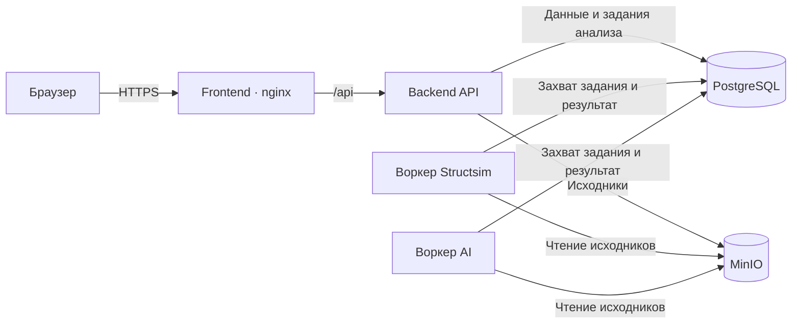

# Архитектура

IntegrityLens состоит из frontend, backend, PostgreSQL, MinIO и двух воркеров:
Structsim и AI-детектора. Обработка работ выполняется локально.

## Компоненты

| Компонент | Ответственность |
|---|---|
| Frontend | Интерфейс преподавателя и студента. nginx отдаёт приложение и проксирует `/api` в backend. |
| Backend | Авторизация, доступ к данным, задания и сдачи, постановка анализа в очередь, расчёт риска, выдача результатов. |
| PostgreSQL | Пользователи, сессии, задания, история сдач, очередь прогонов и результаты. |
| MinIO | Файлы работ в UTF-8. Ключи объектов и сроки хранения находятся в PostgreSQL. |
| Воркер Structsim | Сравнение работ задания между собой и с работами выбранных источников. |
| Воркер AI | Анализ машинного происхождения отдельной сдачи. |

Backend владеет схемой БД и миграциями. Воркеры читают входы прогонов и
записывают результаты по [контрактам](contracts.md). Общий риск рассчитывает backend.

## Сдача и анализ

1. Студент входит в систему и отправляет один Java-файл по ссылке задания.
2. Backend проверяет доступ, возможность сдачи и файл, затем сохраняет исходник в MinIO.
3. Транзакция PostgreSQL сохраняет сдачу, закрывает попытку, обновляет текущую
   сдачу студента и создаёт задания анализа.
4. Воркеры забирают задания из PostgreSQL, скачивают исходники и запускают анализаторы.
5. Воркеры проверяют результаты по контрактам и сохраняют их в PostgreSQL.
6. Backend выдаёт преподавателю оценки, совпадения и риск. Frontend запрашивает
   результаты по HTTP; состояния ожидания и ошибок передаются явно.

MinIO и PostgreSQL не образуют общую транзакцию. Порядок компенсации файла
при сбое записи сдачи определён в открытых вопросах [модели данных](data-model.md).

## Очередь

Очередь хранится в `analysis_runs`. Воркер захватывает задание через
`FOR UPDATE SKIP LOCKED` и записывает владельца и номер попытки.
Во время обработки он обновляет heartbeat. Истечение аренды позволяет
другому воркеру повторить обработку в пределах `max_attempts`.

Публикация результата проверяет владельца, номер попытки и актуальность
входа. Устаревшая попытка не перезаписывает результат. Временные сбои
допускают повтор; ошибки отдельных файлов или пар сохраняются в результате.

## Входы и актуальность результатов

Structsim получает зафиксированный набор текущих работ задания (`target`)
и работ источников (`source`). Он сравнивает пары target–target и target–source.
Прогон относится к конкретной ревизии задания.

Изменение текущих работ или источников увеличивает ревизию и делает прежние
прогоны сходства неактуальными. Backend выдаёт результаты актуальной ревизии.

AI-прогон привязан к сдаче и версии модели. Изменение источников сравнения
не требует повторного AI-анализа. Повторная сдача получает новый UUID;
предыдущая сохраняется в истории.

Backend вычисляет сходство работы как максимум оценок её пар. Общий риск
объединяет сходство и AI-оценку по `policyVersion`. Правила хранения,
состояния оценок и открытые вопросы описаны в [модели данных](data-model.md).

## Доступ и хранение

Авторизация использует серверную сессию и cookie `HttpOnly`, `Secure`,
`SameSite=Lax`. Преподаватель получает только свои задания, работы и результаты.
Студенту доступны сдача работы и состояние возможности сдачи. ФИО преподаватель
получает отдельным запросом.

Файлы доступны через backend с проверкой прав. MinIO и PostgreSQL находятся
во внутренней сети. Воркеры не передают исходники внешним сервисам.

Сдачи хранятся три года. Удаление задания скрывает его и закрывает ссылку,
но не удаляет историю сдач досрочно. Очистка использует `object_deletions`:
ключ остаётся в таблице до подтверждения удаления объекта MinIO.

## Развёртывание

Общий Docker Compose запускает `web`, `api`, `postgres`, `minio`,
`worker-structsim` и `worker-ai`. Служебный контейнер `minio-init` создаёт bucket.
PostgreSQL и MinIO используют постоянные тома. Настройки и секреты передаются
через окружение. Модель AI поставляется локально вместе с образом или артефактами.

nginx принимает HTTPS и передаёт запросы `/api` в backend. Завершение TLS
может выполнять внешний reverse proxy перед nginx. Параметры запуска описаны
в [инфраструктуре репозитория](https://github.com/ITMO-Red-Team/IntegrityLens/tree/main/infra).
