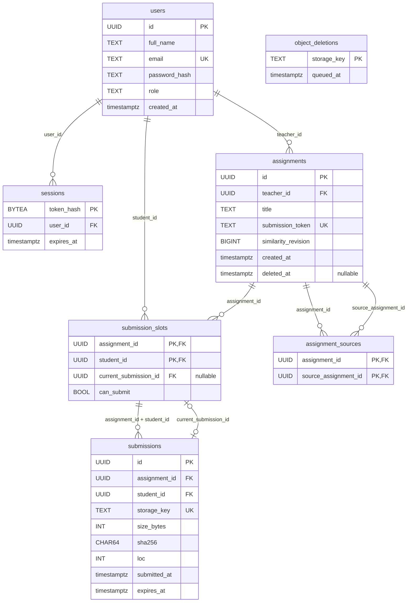
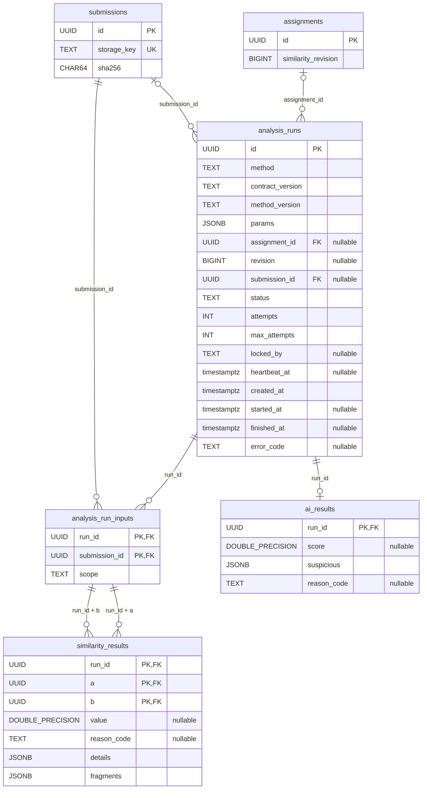

# Модель данных

Модель определяет хранение пользователей, заданий, сдач и результатов анализа.
Методы анализа — Structsim и AI-детектор. Форматы обмена описаны в
[контрактах](contracts.md), взаимодействие компонентов — в [архитектуре](architecture.md).

## Как читать схемы

PK — первичный ключ, FK — внешний ключ, UK — уникальное значение.
Несколько полей с PK образуют составной первичный ключ. Пометка nullable
означает, что поле допускает NULL. Линии показывают связи: кружок — ноль,
черта — один, развилка — много. Время хранится в timestamptz.

## Пользователи, задания и сдачи

MinIO хранит исходник UTF-8 по `submissions/{id}/source.java`.
`storage_key` связывает запись сдачи с объектом; `object_deletions` содержит
ключи для удаления объектов. Это связь между хранилищами, а не внешний ключ БД.

### Доступ и источники

Преподаватель читает только свои задания, работы и результаты. ФИО и studentId передаются с работами; frontend скрывает ФИО до переключения отображения. Email нормализуется удалением пробелов по краям и приведением всего адреса к нижнему регистру; нормализованное значение уникально; пароль хранится как хеш.
Сессия связывает пользователя с хешем токена и сроком действия.
Регистрация создаёт учётную запись без сессии. Отдельный вход создаёт сессию
на 24 часа без продления при обращениях. Пароль содержит 8–128 символов.

Источники сравнения — любые другие неудалённые задания того же преподавателя. Удаление задания
скрывает его, закрывает ссылку сдачи и убирает его из набора источников.
Удаление задания не сокращает трёхлетний срок хранения сдач.

### Приём и повторная сдача

Сдача содержит один непустой `.java` в UTF-8, размером до 1 000 000 байт.
Исходник хранится в MinIO по ключу `submissions/{id}/source.java`.

После записи файла в MinIO одна транзакция PostgreSQL сохраняет сдачу,
обновляет `current_submission_id`, закрывает попытку и ставит анализ в очередь.
MinIO не участвует в транзакции PostgreSQL.

Сброс попытки преподавателем открывает повторную сдачу. Новая сдача получает
новый UUID и заменяет `current_submission_id`; прежняя остаётся в истории.
`submission_slots` хранит текущее состояние попытки студента по заданию,
`submissions` — всю историю его сдач.

### Хранение и удаление

Через три года после сдачи удаляются файл и связанные результаты.
`object_deletions` хранит ключ объекта до подтверждения удаления в MinIO.
Это позволяет повторять удаление после сбоя хранилища.

## Прогоны и результаты

Результат пары ссылается составными FK на входы `(run_id, a)` и `(run_id, b)`.
Поэтому обе работы пары принадлежат зафиксированному входу этого прогона.

### Два вида анализа

- Сходство: один прогон Structsim на `(assignment_id, revision, method)`.
  Вход фиксирует текущие работы (`target`) и работы источников (`source`).
- AI: один прогон на `(submission_id, method_version)`. Изменение набора
  сравнения не требует повторной оценки того же файла.

Для `n` целевых работ и `m` работ источников сравниваются
`n × (n − 1) / 2 + n × m` пар. Пары источник–источник не нужны.
Порядок UUID в паре канонический: `a < b`. При отсутствии пар прогон сходства
пропускается; оценка сходства работы получает `not_applicable`.

### Ревизии

Новая сдача, замена работы, изменение источников или их работ создают новую
ревизию. API читает только результаты актуальной ревизии. Старый прогон не
должен публиковать результат как актуальный после изменения входа.

### Очередь и публикация

Состояния: `queued → running → done | failed | cancelled`.
Временный сбой или истечение аренды допускают повтор в пределах `max_attempts`.
Захват выполняется через `FOR UPDATE SKIP LOCKED`.

При публикации транзакция проверяет аренду, номер попытки и ревизию.
Устаревшие прогоны отменяются. `done` допускает ошибки отдельных пар или файлов;
ошибочная оценка хранится как `NULL` с кодом причины. Ноль — успешная оценка.

## Оценки для интерфейса

Сходство работы — максимум по её парам Structsim. При отсутствии кандидатов
оно неприменимо. AI-оценка рассчитывается отдельно. Состояния методов независимы;
ожидание или ошибка одного метода не скрывают результат другого.

Список сортируется по выбранному методу: Structsim (по умолчанию) или AI.
Оценки идут по убыванию, при равенстве — по UUID, NULL в конце.
Работа завершена, когда оба метода имеют терминальное состояние.
Общая оценка и версия политики объединения не хранятся.

## Ограничения целостности

`current_submission_id` ссылается на сдачу того же задания и студента.
При записи backend проверяет роль преподавателя-владельца и роль студента.
Одновременный приём двух работ сериализуется по паре `(assignment_id, student_id)`.

Для прогона Structsim обязательны `assignment_id` и `revision`,
`submission_id` отсутствует. Для AI обязателен `submission_id`,
`assignment_id` и `revision` отсутствуют. AI-воркер получает одну сдачу на
прогон БД; возможность пакетного входа инструмента не меняет эту связь.

Сброс попытки атомарно сравнивает `expectedSubmissionId` с текущей сдачей.
Несовпадение не изменяет слот. Исторические сдачи не доступны через HTTP API.

Сходство остаётся `pending` до завершения всех требуемых пар, затем получает
`failed` при любой ошибке. Частичный максимум не используется.

## Реализация хранения

- Изменения заданий и сдач одного преподавателя сериализуются блокировкой его записи.
  Слот первой сдачи создаётся в транзакции приёма. Текущая сдача проверяется составным FK.
- При смене версии AI для текущих сдач создаются прогоны новой версии.
  Для иной конфигурации модели используется отдельная версия метода.
- При изменении текущих сдач обновляются ревизии задания и его прямых потребителей.
  Взаимные связи источников допустимы. Самоссылки запрещены.
- Ключ файла ставится в очередь удаления до загрузки в MinIO и снимается
  вместе с подтверждённой записью сдачи. При истечении срока хранения backend
  очищает ссылку текущего слота и пересчитывает зависимые ревизии.

`CHAR64` на схемах означает SQL `CHAR(64)`, `DOUBLE_PRECISION` —
`DOUBLE PRECISION`. Поля с пометкой `nullable` допускают `NULL`.
Таблицы `assignments` и `submissions` на второй схеме показаны сокращённо.
