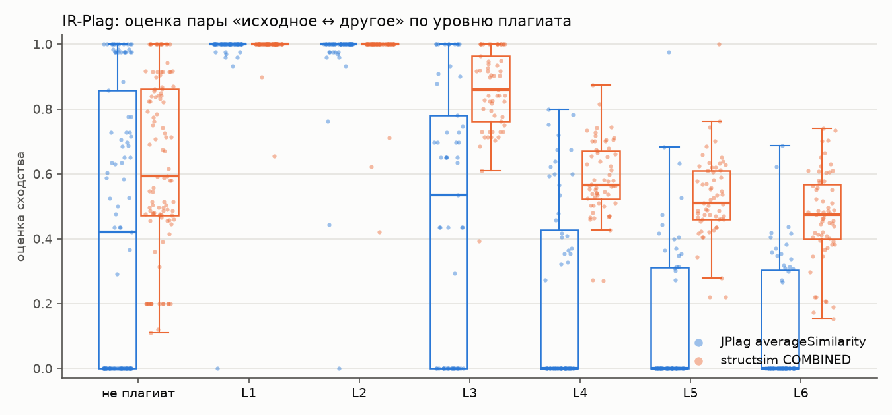

# e01 — IR-Plag: учебные задачи с уровнями плагиата

```bash
uv run python experiments/e01_irplag/run.py      # ~1 мин
```

Результаты: [`results/e01_irplag/`](../../results/e01_irplag/). Там
`scores.csv` с оценками каждой пары обоими инструментами, `metrics.csv`,
`auc_by_level.csv`, `score_by_level.csv`, `auc_by_case.csv`, `summary.json`
(покрытие, бутстрэп, F1) и рисунок.

## Постановка

**Данные.** [IR-Plag](https://github.com/oscarkarnalim/sourcecodeplagiarismdataset)
(Karnalim et al., *Informatics in Education*, 2019), коммит `f07e951`. В нём
7 вводных задач на Java и 467 файлов. На каждую задачу есть исходное решение,
15 решений, написанных независимо, и 40–54 списанных с исходного. Списанные
разбиты на шесть уровней маскировки по Faidhi & Robinson:

| Уровень | Что меняли |
|---|---|
| L1 | комментарии, отступы |
| L2 | имена |
| L3 | места объявлений, порядок независимых операторов |
| L4 | вынос в функции |
| L5 | сами операторы (эквивалентная замена) |
| L6 | логику управления |

**Протокол** — как у авторов набора: исходное решение сравнивается с каждым
остальным. Положительный класс — 355 списанных, отрицательный — 105
независимых. Всего 460 пар. Решения №13 и №15 в `non-plagiarized`, возможно,
списаны друг у друга (issue #3 набора), но друг с другом они здесь не
сравниваются, поэтому на результат это не влияет.

**Инструменты** — с настройками по умолчанию: JPlag `-t 9`, structsim как есть.
Основные оценки — JPlag `averageSimilarity` и structsim `COMBINED`. Остальные
приведены для разбора. Не разобрался ни один файл ни у одного инструмента: 0
из 467.

## Результат

| Оценка | ROC-AUC | AP | среднее: плагиат | среднее: не плагиат | доля ровно 0.0 у неплагиата |
|---|---|---|---|---|---|
| JPlag averageSimilarity | 0.556 | 0.816 | 0.471 | 0.410 | 48% |
| JPlag maxSimilarity | 0.544 | 0.797 | 0.486 | 0.425 | 48% |
| **structsim COMBINED** | **0.611** | **0.841** | 0.730 | 0.633 | 0% |
| structsim мера 1 (порядок) | 0.554 | 0.826 | 0.770 | 0.736 | 0% |
| structsim мера 2 (фрагменты) | 0.660 | 0.854 | 0.609 | 0.428 | 15% |
| structsim мера 3 (функции) | 0.594 | 0.837 | 0.809 | 0.737 | 0% |
| structsim contrast-z | 0.607 | 0.863 | — | — | — |

Разница structsim − JPlag avg (парный бутстрэп, 2000 повторов, 95% интервал):
**ROC-AUC +0.055 [+0.021; +0.088]**, AP +0.025 [+0.004; +0.046]. Против JPlag
max: ROC-AUC +0.067 [+0.034; +0.100]. По задачам structsim выше в 6 из 7.

Отделимость каждого уровня от независимых решений (ROC-AUC «Lk против всех
неплагиатов») и средняя оценка на уровне:

| Уровень | пар | AUC JPlag avg | AUC structsim | среднее JPlag avg | среднее structsim | JPlag: доля ровно 0.0 |
|---|---|---|---|---|---|---|
| не плагиат | 105 | — | — | 0.410 | 0.633 | 48% |
| L1 | 60 | 0.911 | **0.928** | 0.979 | 0.993 | 2% |
| L2 | 56 | 0.892 | **0.910** | 0.963 | 0.978 | 2% |
| L3 | 57 | 0.539 | **0.743** | 0.461 | 0.857 | 39% |
| L4 | 60 | 0.377 | 0.448 | 0.218 | 0.587 | 58% |
| L5 | 59 | 0.327 | 0.372 | 0.134 | 0.528 | 70% |
| L6 | 63 | 0.319 | 0.302 | 0.115 | 0.468 | 70% |



F1 при пороге, выбранном на шести задачах и проверенном на седьмой: 0.871 у
обоих инструментов. Число неинформативное: плагиата в наборе 77%, и правило
«всё плагиат» даёт F1 = 0.871. У JPlag выбранный порог именно к этому и
сводится (полнота 1.0, точность 0.772).

## Интерпретация

**Общий AUC низкий у обоих, и это свойство набора, а не инструментов.** Задачи
крошечные, медиана 28 строк (например, «площадь и объём цилиндра»).
Независимые решения таких задач почти совпадают с исходным: у JPlag половина
из них получает ≥ 0.42, а часть — ровно 1.0. Списанные на L4–L6, наоборот,
перестроены нарочно: код вынесен в функции, операторы заменены, добавлены
циклы. По устройству они дальше от оригинала, чем честные решения. Отсюда
AUC < 0.5 на L4–L6 у обоих инструментов: метод, измеряющий сходство
устройства, такие уровни отделить и не должен. Плагиат, который можно
распознать по сходству кода, — это L1–L3.

**Главная разница на L3: 0.743 против 0.539.** У JPlag в файле этого набора
медиана 23 метки (`tokens_*` в `scores.csv`). Перестановка операторов режет
такую программу на куски короче порога 9, и 39% пар уровня L3 получают
ровно 0.0, то есть выглядят как не связанные вовсе. structsim переживает
перестановку за счёт мер 2 и 3: фрагменты по 5 меток не зависят от порядка, а
блоки сопоставляются функция с функцией. Метки у structsim к тому же мельче:
на тех же файлах медиана 40 меток против 23, так что общих фрагментов
остаётся больше.

**L1–L2 оба ловят почти идеально.** Переименование и переформатирование
нивелируют оба. Небольшой проигрыш JPlag здесь объясняется независимыми
решениями, которые у него тоже получают 1.0.

**Сырые оценки structsim выше всюду**, у плагиата и у неплагиата: 0.73 против
0.47 и 0.63 против 0.41. Ноль structsim не выдаёт никогда, JPlag выдаёт
ровно 0.0 почти половине независимых пар. Шкалы разные, и порог одного
инструмента к другому не переносится.

Из составляющих structsim лучше всех мера 2 «фрагменты» (0.660): она одна не
зависит ни от порядка, ни от разбиения на функции. Мера 1 «порядок» на этом
наборе не лучше JPlag.

## Вывод

На учебных задачах с синтетическим плагиатом **structsim отделяет плагиат
лучше JPlag**: ROC-AUC 0.611 против 0.556, разница значима, structsim выше в
6 задачах из 7. Выигрыш почти целиком приходится на L3 (перестановки), где
JPlag с порогом по умолчанию обнуляет короткие совпадения. На L4–L6 оба
инструмента не работают, и по построению набора это ожидаемо. Ограничение:
программы здесь на порядок короче настоящих, поэтому основной вес вывода
переносится на e02.
