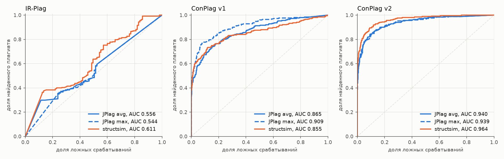

# e02 — ConPlag: настоящие олимпиадные решения

```bash
uv run python experiments/e02_conplag/run.py     # ~5 мин; почти всё время — contrast-z по всем парам
```

Результаты: [`results/e02_conplag/`](../../results/e02_conplag/), по
поддиректории на каждую версию набора (`v1/`, `v2/`). В каждой лежат
`scores.csv`, `metrics.csv`, `auc_by_problem.csv`, `auc_by_length_ratio.csv`,
`summary.json` и рисунок. ROC-кривые всех трёх наборов — `roc.png`.

## Постановка

**Данные.** [ConPlag](https://zenodo.org/records/7332790) (Slobodkin &
Sadovnikov, 2022), CC BY 4.0. Это 911 размеченных пар настоящих решений с
Codeforces на Java по 21 задаче: 251 пара — плагиат, 660 — нет. Медиана длины
— 109 строк. Набор есть в двух версиях:

- **v1** — решения как сданы, вместе с олимпиадными шаблонами (быстрый ввод,
  утилиты);
- **v2** — шаблонный код вычищен авторами вручную, медиана 66 строк.

Авторы разбили пары на train (230) и test (681). Порог для F1 выбирается на
train и проверяется на test.

**Раскладка.** JPlag запускается один раз на задачу, и из `results.csv`
берутся размеченные пары. Без `-bc` оценка пары от остальных решений в
запуске не зависит. У 10 решений в v1 и у 13 в v2 копии в директориях разных
пар расходятся по содержимому. Поэтому имя решения включает хеш файла, и
каждая пара сравнивается ровно по своим двум файлам.

**Покрытие.** В v1 разобраны все файлы. В v2 JPlag не разобрал 2 файла
(`CANNOT_PARSE`), structsim — 1 из них (синтаксическая ошибка после ручной
чистки). Сравнение идёт на 909 парах из 911, на которых оценку дали оба
инструмента.

**Инструменты** — с настройками по умолчанию, как в e01.

## Результат

| Оценка | v1: ROC-AUC | v1: AP | v2: ROC-AUC | v2: AP |
|---|---|---|---|---|
| JPlag averageSimilarity | 0.865 | 0.796 | 0.940 | 0.897 |
| JPlag maxSimilarity | **0.909** | **0.857** | 0.939 | 0.897 |
| structsim COMBINED | 0.855 | 0.809 | **0.964** | **0.934** |
| structsim мера 1 (порядок) | 0.823 | 0.780 | 0.948 | 0.915 |
| structsim мера 2 (фрагменты) | 0.861 | 0.809 | 0.965 | 0.935 |
| structsim мера 3 (функции) | 0.868 | 0.820 | 0.954 | 0.920 |
| structsim contrast-z | 0.839 | 0.779 | 0.931 | 0.886 |

Разница structsim COMBINED − JPlag (парный бутстрэп, 95% интервал):

| | v1 | v2 |
|---|---|---|
| ROC-AUC, против avg | −0.011 [−0.032; +0.011], не значима | **+0.024 [+0.009; +0.040]** |
| AP, против avg | +0.013 [−0.009; +0.035], не значима | **+0.037 [+0.017; +0.058]** |
| ROC-AUC, против max | **−0.054 [−0.086; −0.025]** | **+0.025 [+0.010; +0.041]** |
| AP, против max | **−0.047 [−0.082; −0.016]** | **+0.037 [+0.017; +0.060]** |

F1 на test при пороге, выбранном на train:

| | v1: F1 | точность | полнота | v2: F1 | точность | полнота |
|---|---|---|---|---|---|---|
| JPlag avg | 0.680 | 0.705 | 0.656 | 0.773 | 0.836 | 0.719 |
| JPlag max | **0.771** | 0.773 | 0.769 | 0.780 | 0.853 | 0.719 |
| structsim COMBINED | 0.698 | 0.853 | 0.591 | **0.829** | 0.847 | 0.811 |

Сырые оценки, среднее по классу:

| | v1: плагиат | v1: не плагиат | v2: плагиат | v2: не плагиат |
|---|---|---|---|---|
| JPlag avg | 0.574 | 0.168 | 0.681 | 0.172 |
| structsim COMBINED | 0.661 | 0.327 | 0.788 | 0.409 |

По задачам (AUC structsim против JPlag avg): в v1 structsim выше в 6 задачах,
JPlag в 10, ничьих 5. В v2 structsim выше в 8, JPlag в 4, ничьих 9 (во
всех девяти у обоих 1.0).

**Разрез v1 по соотношению длин пары** (в метках structsim):

| Пары | n | плагиат | JPlag avg | JPlag max | structsim |
|---|---|---|---|---|---|
| длины близки (≤ 1.5) | 457 | 164 | 0.922 | 0.929 | **0.943** |
| длины расходятся (> 1.5) | 454 | 87 | 0.785 | **0.870** | 0.753 |



## Интерпретация

**Без шаблонов (v2) structsim лучше JPlag по всем метрикам**, и разница
значима: AUC 0.964 против 0.940, F1 на test 0.829 против 0.773. Выигрыш
приходится на полноту (0.81 против 0.72) при той же точности. Это та же
картина, что в e01: structsim находит списанное с переделками, которые рвут
длинные общие куски JPlag.

**С шаблонами (v1) structsim наравне с JPlag avg, но уступает JPlag max.**
Причину показывает разрез по длинам. Когда длины пары близки, structsim
по-прежнему лучше (0.943 против 0.929). Проигрывает он на парах, где один
файл в полтора и более раза длиннее другого. Это типичный олимпиадный
плагиат: чужое решение вставлено в свой шаблон быстрого ввода. Все три меры
structsim и JPlag avg симметричны: лишний шаблон раздувает знаменатель, и
оценка падает. JPlag max — односторонняя мера «какая доля меньшей программы
покрыта общими кусками», и шаблон её не портит (0.870 против 0.753). В v2
шаблоны вычищены, и разница между max и avg у JPlag на плагиате почти
исчезает: в среднем 0.03 против 0.11 в v1.

**Шаблоны сжимают шкалу structsim.** С шаблонами оценки ниже у обоих
классов: у плагиата 0.66 против 0.79 без них, у неплагиата 0.33 против 0.41.
Разрыв между классами сужается с 0.38 до 0.33. Неплагиат без шаблонов
получает более высокие оценки, потому что после чистки остаются ядра решений
одной задачи, а они устроены похоже.

**contrast-z не улучшает ранжирование размеченных пар.** По AUC он ниже
`COMBINED` во всех трёх наборах; по AP выше только на IR-Plag. Фон, посчитанный
по задаче, отвечает на другой вопрос — «выделяется ли пара на фоне группы», а
не «плагиат ли это».

## Вывод

На реальных олимпиадных решениях Java итог зависит от шаблонного кода:

- **без шаблонов** structsim значимо лучше JPlag (AUC +0.024, F1 +0.05);
- **с шаблонами** structsim наравне с JPlag avg, но значимо хуже JPlag max
  (AUC −0.054). Причина — частичное заимствование в обёртке своего шаблона:
  structsim не видит включения меньшей программы в большую.

Для structsim отсюда два направления. Первое — односторонняя мера в духе
`maxSimilarity`, например доля меньшей программы, покрытая фрагментами или
блоками. Второе — исключение общего кода, аналог `-bc` у JPlag.
