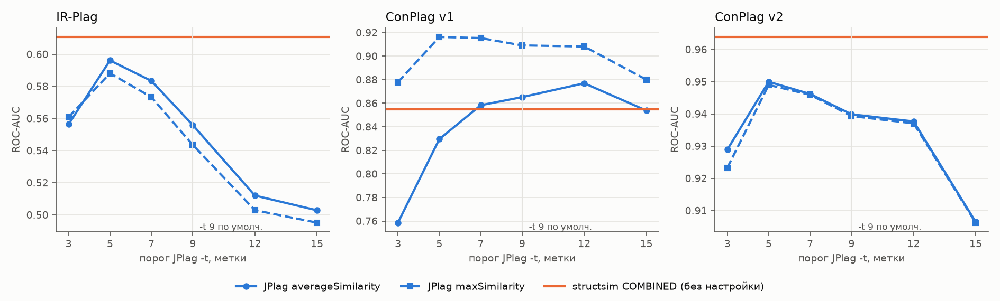

# e03 — не держится ли вывод на настройке JPlag

```bash
uv run python experiments/e03_jplag_threshold/run.py    # ~5 мин; нужны результаты e01 и e02
```

Результаты: [`results/e03_jplag_threshold/`](../../results/e03_jplag_threshold/):
`grid.csv` (все настройки, с разницей structsim − JPlag и её интервалом),
`best.csv` (лучшая настройка против по умолчанию, с тем же интервалом) и
рисунок.

## Постановка

В e01 и e02 оба инструмента запущены по умолчанию. Но порог JPlag `-t 9`
подобран для программ крупнее учебных: в e01 он обнулял 39% пар уровня L3.
Возможно, structsim выигрывает только у ненастроенного JPlag. Проверяем:
JPlag прогоняется по сетке `-t` ∈ {3, 5, 7, 9, 12, 15} и при `-t 9
--normalize`, на тех же парах, что в e01/e02. structsim не настраивается —
его оценки берутся из e01/e02 как есть.

Выбор лучшего `-t` задним числом на тех же данных, на которых он
оценивается, — **оптимистичная для JPlag** оценка. Проверка заведомо
устроена в его пользу.

## Результат

ROC-AUC:

| Набор | structsim | JPlag avg, `-t 9` | JPlag max, `-t 9` | лучший JPlag avg | лучший JPlag max |
|---|---|---|---|---|---|
| IR-Plag | **0.611** | 0.556 | 0.544 | 0.596 (`-t 5`) | 0.588 (`-t 5`) |
| ConPlag v1 | 0.855 | 0.865 | 0.909 | 0.877 (`-t 12`) | **0.916** (`-t 5`) |
| ConPlag v2 | **0.964** | 0.940 | 0.939 | 0.950 (`-t 5`) | 0.949 (`-t 5`) |

Разница structsim − JPlag по ROC-AUC при пороге по умолчанию и при лучшем
для JPlag (парный бутстрэп, 2000 повторов, 95% интервал; строки `-t 9` те же,
что в e01/e02):

| Набор | против avg, `-t 9` | против avg, лучший `-t` | против max, `-t 9` | против max, лучший `-t` |
|---|---|---|---|---|
| IR-Plag | **+0.055 [+0.021; +0.088]** | +0.015 [−0.016; +0.045] (`-t 5`) | **+0.067 [+0.034; +0.100]** | +0.023 [−0.009; +0.054] (`-t 5`) |
| ConPlag v1 | −0.011 [−0.032; +0.011] | −0.022 [−0.046; +0.001] (`-t 12`) | **−0.054 [−0.086; −0.025]** | **−0.062 [−0.093; −0.031]** (`-t 5`) |
| ConPlag v2 | **+0.024 [+0.009; +0.040]** | **+0.014 [+0.002; +0.027]** (`-t 5`) | **+0.025 [+0.010; +0.041]** | **+0.015 [+0.002; +0.028]** (`-t 5`) |

Жирным — интервалы, не содержащие нуля. Разница при каждом `-t` сетки — в
`grid.csv`, столбцы `ss_minus_*`.

`--normalize` (нормализация меток, поддержана для Java) не помогает нигде:
0.521 на IR-Plag, 0.862 на v1 и 0.937 на v2 против 0.556, 0.865 и 0.940 без
неё.



На IR-Plag при `-t 12` и `-t 15` JPlag отбрасывает 33 и 81 решение как
`TOO_SMALL`: в них меньше меток, чем порог. Пары с ними считаются 0.0 —
именно так JPlag и ведёт себя на таком входе.

## Интерпретация

Порог у JPlag действительно не оптимален: на всех трёх наборах лучшим
оказывается `-t 5`, за одним исключением — `avg` на v1. Выигрыш от настройки
небольшой (+0.01…+0.04 AUC), и **точечный порядок инструментов он не
меняет**, но меняет уверенность в нём:

- на IR-Plag перевес structsim над JPlag при `-t 5` сжимается с +0.055 до
  +0.015 AUC, и интервал накрывает ноль. Против JPlag с порогом, подобранным
  задним числом, перевес structsim на этом наборе **в пределах шума**. Это
  согласуется с e01: выигрыш там шёл почти целиком с уровня L3, где `-t 9`
  обнулял короткие совпадения;
- на ConPlag v2 structsim остаётся значимо выше и при лучшем `-t`, но запас
  невелик: +0.014 [+0.002; +0.027] против +0.024 по умолчанию;
- на ConPlag v1 JPlag max выше structsim при любом пороге сетки, от 3 до 15,
  то есть и по умолчанию. Его преимущество — в односторонней мере (e02), а не
  в пороге. JPlag avg при `-t 12` тоже обходит structsim, но не значимо
  (−0.022 [−0.046; +0.001]).

Понижать `-t` ниже 5 вредно везде. Это согласуется с
[ловушкой 2](../../../../tools/jplag/pitfalls.md#2-порог--t-отсекает-обвязку):
на малом пороге совпадают обвязка и шаблон, а не алгоритм.

## Вывод

Порядок инструментов от настройки JPlag не зависит, а сила вывода зависит.
Против JPlag с порогом, подобранным задним числом на тех же данных, значимый
перевес structsim остаётся только на ConPlag v2; на IR-Plag он в пределах
шума, на v1 JPlag max впереди при любом пороге. Для baseline оставляем `-t 9`
по умолчанию: так его используют в литературе, а выигрыш от `-t 5` мал и
получен подбором на тех же данных. Но вывод «structsim лучше JPlag» следует
формулировать с оговоркой: на реальных данных без шаблонов — да, на учебном
IR-Plag — только против JPlag по умолчанию.
