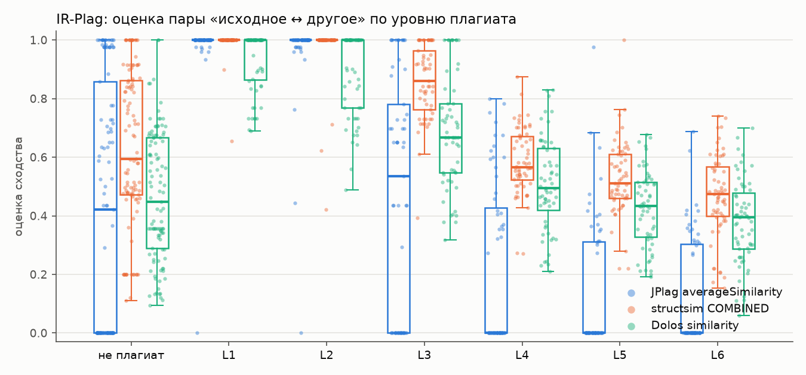
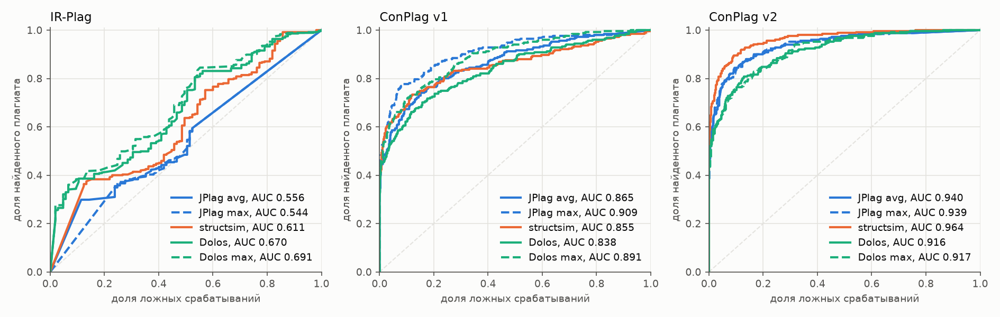

# e04 — Dolos как третий инструмент

```bash
uv run python experiments/e04_dolos/run.py     # ~1 мин; если Dolos не стоит, сначала npm ci (~30 с)
```

Результаты: [`results/e04_dolos/`](../../results/e04_dolos/). Сводка по трём
наборам: `metrics.csv` (ROC-AUC, AP, F1 при перенесённом пороге) и
`bootstrap.csv` (парный бутстрэп). ROC-кривые — `roc.png`. По поддиректории на
набор (`irplag/`, `conplag-v1/`, `conplag-v2/`), в каждой `scores.csv`,
`metrics.csv`, `auc_by_group.csv`, разрез (`auc_by_level.csv` или
`auc_by_length_ratio.csv`), `coverage.json` и `summary.json`.

## Постановка

**Вопрос.** В issue baseline назван Dolos, а в e01–e03 baseline был JPlag.
Меняется ли ответ, если добавить Dolos третьим инструментом?

**Инструмент.** [Dolos](https://dolos.ugent.be) 2.9.3 (npm `@dodona/dolos`,
Гентский университет), CLI, без Docker. Версия прибита в `package.json`,
версии и sha512 всех зависимостей — в `package-lock.json`. Ставится
`npm ci` в `research/one/node_modules/`: это делают `fetch` или сама обёртка
[`dolos.py`](../../src/research_one/dolos.py), если Dolos ещё не стоит.
Нужен Node.js ≥ 18; прогон шёл на Node 24.11.1. Установка весит 470 МБ:
почти всё — грамматики tree-sitter всех языков Dolos, которые собираются при
установке.

Dolos разбирает файл tree-sitter и записывает дерево как последовательность
типов именованных узлов в скобках: `( method_invocation ( identifier ) …`.
Имена, значения литералов, операторы и комментарии в неё не попадают. Дальше
строятся k-граммы по 23 метки, и winnowing с окном 17 оставляет отпечатки.
Оценка пары `similarity` — доля отпечатков обеих программ, которые нашлись в
другой. Мера симметричная, как `averageSimilarity` у JPlag.

**Dolos max.** Односторонней меры, как `maxSimilarity` у JPlag, у Dolos нет.
Её можно вывести из тех же столбцов `pairs.csv`: какая доля отпечатков
программы покрыта, берётся большая из двух долей. Это не оценка самого
Dolos, а проверка, помогает ли ему тот же приём, что JPlag на ConPlag v1.

**Настройки** — по умолчанию: `dolos run -l java -f csv`. Справка CLI
утверждает, что по умолчанию `-M 0.9`, то есть отпечатки, которые есть больше
чем в 90% файлов, отбрасываются. В коде 2.9.3 такого умолчания нет:
`metadata.csv` прогона пишет `maxFingerprintPercentage null`. Значит, оценка
пары не зависит от остальных решений в запуске, и Dolos можно запускать один
раз на задачу, как JPlag. Это проверено прямо в прогоне: на каждом наборе
20 случайных пар запущены отдельно, по два файла, и оценки совпали до
последнего знака (`solo_runs` в `coverage.json`).

**Данные и пары** — те же, что в e01 и e02: IR-Plag (460 пар), ConPlag v1
(911) и v2 (911). JPlag и structsim не пересчитываются, их оценки берутся из
`results/e01_irplag/scores.csv` и `results/e02_conplag/v{1,2}/scores.csv`.
Прогон сверяет, что набор даёт ровно те же пары. Сравнение идёт на парах,
которые сравнивались в e01/e02, то есть получили оценку и от JPlag, и от
structsim: 460, 911 и 909.

**Покрытие Dolos.** Файлов, которые не разобрались, у Dolos не бывает:
tree-sitter строит дерево всегда, а на месте ошибки ставит узел `ERROR`.
Узел `ERROR` нашёлся в одном файле: `db7f80a5` в ConPlag v2, тот же, на
котором падают и JPlag, и structsim. Его пара в сравнение и так не входит.
Файл `d6af96bd`, который не разобрал JPlag, Dolos разобрал без ошибок. Файлов
без единого отпечатка нет.

**Метрики и порог** — те же, что в e01/e02 ([`metrics.py`](../../src/research_one/metrics.py)):
ROC-AUC, AP, F1 при пороге, выбранном на одной части данных и проверенном на
другой. Для IR-Plag порог выбирается по шести задачам и проверяется на
седьмой, для ConPlag — на train авторов и проверяется на test. Разница
Dolos − соперник оценивается парным бутстрэпом (2000 повторов, 95% интервал).

## Результат

| Оценка | IR-Plag: AUC | AP | ConPlag v1: AUC | AP | ConPlag v2: AUC | AP |
|---|---|---|---|---|---|---|
| JPlag averageSimilarity | 0.556 | 0.816 | 0.865 | 0.796 | 0.940 | 0.897 |
| JPlag maxSimilarity | 0.544 | 0.797 | **0.909** | **0.857** | 0.939 | 0.897 |
| structsim COMBINED | 0.611 | 0.841 | 0.855 | 0.809 | **0.964** | **0.934** |
| **Dolos similarity** | **0.670** | **0.878** | 0.838 | 0.770 | 0.916 | 0.860 |
| Dolos max (выведена) | 0.691 | 0.886 | 0.891 | 0.826 | 0.917 | 0.857 |

Строки JPlag и structsim совпадают с e01 и e02: пары и оценки те же.
Жирным выделен лучший из трёх инструментов по их собственным оценкам.

Разница Dolos − соперник (парный бутстрэп, 95% интервал):

| | IR-Plag | ConPlag v1 | ConPlag v2 |
|---|---|---|---|
| AUC, против JPlag avg | **+0.114 [+0.083; +0.146]** | **−0.027 [−0.047; −0.007]** | **−0.024 [−0.042; −0.003]** |
| AP, против JPlag avg | **+0.062 [+0.045; +0.080]** | **−0.026 [−0.046; −0.007]** | **−0.037 [−0.063; −0.011]** |
| AUC, против JPlag max | **+0.127 [+0.094; +0.160]** | **−0.071 [−0.101; −0.043]** | **−0.023 [−0.042; −0.002]** |
| AP, против JPlag max | **+0.081 [+0.062; +0.100]** | **−0.086 [−0.118; −0.057]** | **−0.037 [−0.063; −0.010]** |
| AUC, против structsim | **+0.059 [+0.025; +0.092]** | −0.017 [−0.036; +0.002], не значима | **−0.048 [−0.066; −0.030]** |
| AP, против structsim | **+0.037 [+0.018; +0.055]** | **−0.039 [−0.062; −0.018]** | **−0.074 [−0.099; −0.051]** |

F1 при перенесённом пороге (IR-Plag — на седьмой задаче, ConPlag — на test):

| | IR-Plag: F1 | ConPlag v1: F1 | точность | полнота | ConPlag v2: F1 | точность | полнота |
|---|---|---|---|---|---|---|---|
| JPlag avg | 0.871 | 0.680 | 0.705 | 0.656 | 0.773 | 0.836 | 0.719 |
| JPlag max | 0.871 | **0.771** | 0.773 | 0.769 | 0.780 | 0.853 | 0.719 |
| structsim COMBINED | 0.871 | 0.698 | 0.853 | 0.591 | **0.829** | 0.847 | 0.811 |
| Dolos similarity | 0.869 | 0.634 | 0.741 | 0.554 | 0.746 | 0.781 | 0.714 |
| Dolos max | 0.877 | 0.706 | 0.779 | 0.645 | 0.708 | 0.788 | 0.643 |

На IR-Plag F1 неинформативен, как и в e01: плагиата в наборе 77%, и правило
«всё плагиат» даёт 0.871.

По задачам AUC Dolos выше, чем у JPlag avg, в 6 задачах IR-Plag из 7, в 3
задачах ConPlag v1 из 21 (ниже в 11) и в 3 задачах v2 из 21 (ниже в 10).
Против structsim: 4 из 7, 5 из 21 (ниже в 12) и 2 из 21 (ниже в 11).

Сырые оценки Dolos, среднее по классу: на плагиате 0.63 (IR-Plag), 0.56
(v1), 0.63 (v2), на неплагиате 0.47, 0.21, 0.24. Ровно 0.0 Dolos не выдал ни
одной паре. JPlag выдаёт его 13–48% честных пар.

**IR-Plag по уровням** (AUC «Lk против всех неплагиатов» и средняя оценка
Dolos):

| Уровень | JPlag avg | structsim | Dolos | Dolos max | среднее Dolos |
|---|---|---|---|---|---|
| не плагиат | — | — | — | — | 0.468 |
| L1 | 0.911 | 0.928 | **0.971** | 0.968 | 0.931 |
| L2 | 0.892 | 0.910 | **0.937** | 0.936 | 0.887 |
| L3 | 0.539 | 0.743 | **0.760** | 0.754 | 0.686 |
| L4 | 0.377 | 0.448 | **0.550** | 0.598 | 0.505 |
| L5 | 0.327 | 0.372 | **0.443** | 0.489 | 0.425 |
| L6 | 0.319 | 0.302 | **0.391** | 0.427 | 0.382 |



**ConPlag v1 по соотношению длин пары** (в метках structsim, как в e02):

| Пары | n | плагиат | JPlag avg | JPlag max | structsim | Dolos | Dolos max |
|---|---|---|---|---|---|---|---|
| длины близки (≤ 1.5) | 457 | 164 | 0.922 | 0.929 | **0.943** | 0.912 | 0.916 |
| длины расходятся (> 1.5) | 454 | 87 | 0.785 | **0.870** | 0.753 | 0.719 | 0.843 |

В v2 на парах с близкими длинами (790 пар, 246 плагиат) порядок тот же:
structsim 0.960, JPlag 0.939, Dolos 0.914. Пар с расходящимися длинами там
119, но плагиата среди них всего 4, и AUC по ним ничего не говорит.



## Интерпретация

**На IR-Plag Dolos лучший из трёх**: AUC 0.670 против 0.611 у structsim и
0.556 у JPlag, разница значима против обоих. Выигрыш держится на двух
вещах.

Первая — мелкое зерно. Минимальный общий кусок у Dolos — одна k-грамма, то
есть 23 метки, или около 8 узлов дерева. На IR-Plag это полторы строки: в
медианном файле 101 узел, примерно 5 на непустую строку. У JPlag минимальный
кусок — 9 меток подряд, а во всём медианном файле IR-Plag их 23 (e01). После
перестановки операторов (L3) у Dolos общих k-грамм остаётся много, а у JPlag
куски рвутся короче порога. Отсюда на L3 Dolos 0.760, structsim 0.743 и
JPlag 0.539.

Вторая — Dolos редко путает честные решения с плагиатом. Независимое решение
крошечной задачи у JPlag часто совпадает с исходным целиком: 11% таких пар
получают ровно 1.0. У Dolos оценку ≥ 0.9 получают 2% таких пар, медиана —
0.45. Вероятная причина в том, что Dolos оставляет все именованные узлы,
включая `block` от фигурных скобок и скобки в выражениях: два независимо
написанных решения расходятся в этих мелочах, даже когда их операторы
совпадают. У той же чувствительности есть обратная сторона: Dolos не даёт
1.0 части копий L1. Например, в case-03 копия L1 отличается от исходного
только комментариями, оформлением и фигурными скобками вокруг ветвей
`if`/`else`. У JPlag и structsim она получает 1.0, у Dolos — 0.73: каждая
пара скобок добавила узел `block`.

На IR-Plag Dolos почти совпадает с мерой 2 structsim «фрагменты» (AUC
0.660 в e01). Обе считают долю общих коротких кусков и не зависят от их
порядка.

**На реальных олимпиадных решениях (ConPlag) Dolos слабее обоих
инструментов.** Без шаблонов (v2) он значимо хуже и JPlag (AUC −0.024), и
structsim (−0.048). На парах с близкими длинами, где шаблоны ни при чём,
Dolos тоже последний: 0.914 против 0.939 и 0.960. В v2 плагиат получает у
Dolos в среднем ниже, чем у JPlag (0.63 против 0.68), а неплагиат — выше
(0.24 против 0.17). Вероятно, короткие куски, которые выручали на
28-строчных программах, на решениях по 50–100 строк совпадают и у
независимых решений одной задачи. В метки Dolos к тому же не попадают
операторы, поэтому `i < n` и `i > n` для него одно и то же. Это объяснение
отдельно не проверялось: чувствительность Dolos к `-k` и `-w` не изучалась,
а для JPlag такую проверку делал e03.

**С шаблонами (v1) Dolos проигрывает по той же причине, что structsim.** На
парах, где один файл в полтора раза длиннее другого (своё решение в чужом
шаблоне или наоборот), симметричная оценка Dolos падает до 0.719. Это ниже,
чем у structsim (0.753) и JPlag avg (0.785). Односторонняя мера, выведенная
из тех же отпечатков, поднимает её до 0.843 (+0.053 AUC в целом, значимо) и
почти догоняет JPlag max: 0.891 против 0.909, разница −0.018 [−0.039; +0.002]
не значима. Приём работает одинаково у JPlag и у Dolos. Это ещё один довод
за одностороннюю меру включения для structsim.

**Шкала у Dolos своя.** Нулей у него нет, как и у structsim, а по уровню
оценок он ближе к JPlag: честные пары в среднем получают 0.21–0.47. Порог
одного инструмента на другой, как и раньше, не переносится.

## Вывод

- **Выбор JPlag в качестве baseline подтверждается.** На реальных парах
  (ConPlag) Dolos с настройками по умолчанию значимо хуже JPlag на обеих
  версиях: AUC −0.027 на v1 и −0.024 на v2 против `averageSimilarity`.
  На реальных данных сравнение с Dolos выставило бы structsim в лучшем
  свете, чем сравнение с JPlag.
- **Ответ e01–e03 не меняется.** structsim значимо лучше Dolos без шаблонов
  (v2, AUC +0.048) и наравне с ним с шаблонами (v1, разница по AUC не
  значима, по AP structsim лучше). Лучше всех на v1 по-прежнему JPlag max.
- **Dolos выигрывает только на маленьком синтетическом IR-Plag** (AUC 0.670,
  значимо лучше обоих). Вес у этого набора небольшой, программы по ~28 строк.
  Урок для structsim тот же, что дала мера 2 в e01: на крошечных программах
  выигрывает доля общих коротких кусков без учёта порядка.
- **Односторонняя мера помогает и Dolos** (+0.053 AUC на v1). Это
  подтверждает вывод e02: structsim нужна мера включения меньшей программы
  в большую.
