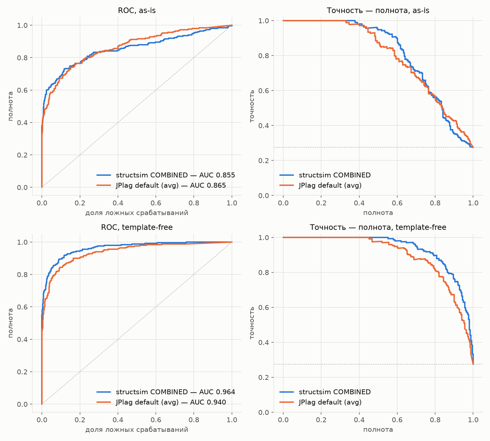
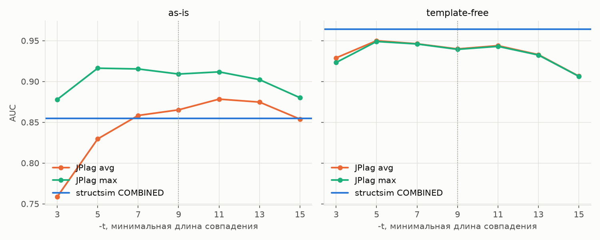
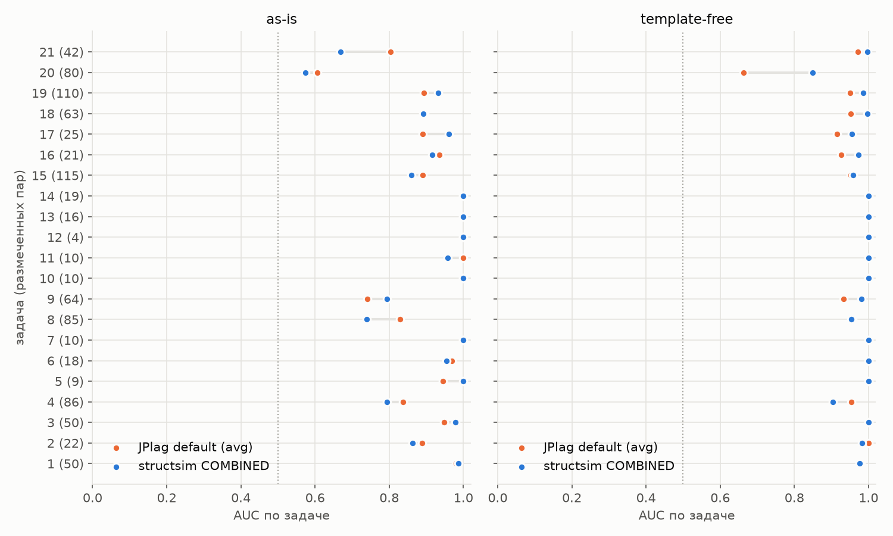
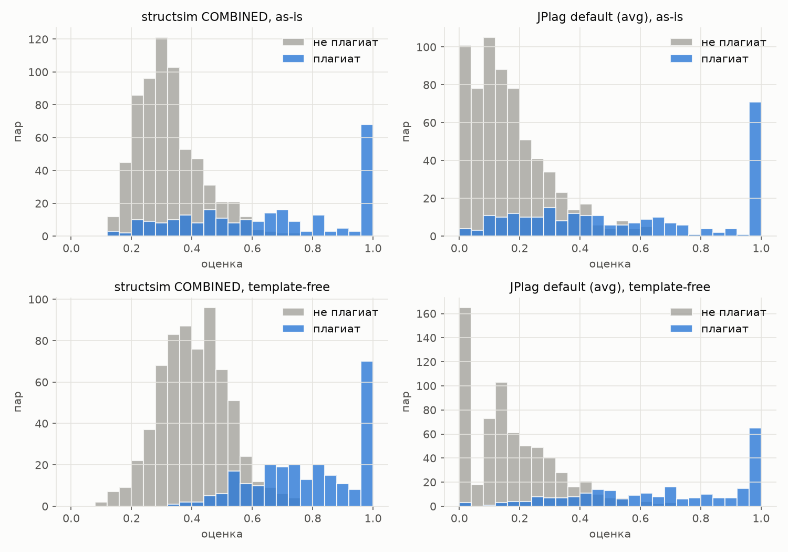

# Эксперимент 2: structsim против JPlag — отчёт

Вопрос, гипотезы и протокол — в [`../README.md`](../README.md). Все числа
ниже получены стадиями `s00`–`s50` и лежат в [`tables/`](tables/) и
[`figures/`](figures/). Версии: JPlag 6.3.0, Semgrep 1.180.0, structsim —
коммит, в котором лежит этот отчёт.

## Коротко

1. **На коде без заготовок structsim значимо лучше JPlag:** AUC 0.964 против
   0.940, разница +0.024, 95% ДИ [+0.010; +0.040], и по задачам
   [+0.008; +0.047]. Перевес сохраняется против всех штатных конфигураций
   JPlag. Против лучшей точки кривой по `-t` (подобранной на этих же данных)
   он есть, но едва значим.
2. **На коде как есть structsim не лучше JPlag.** С метрикой JPlag по
   умолчанию (`avg`) получается ничья: −0.011, ДИ накрывает ноль. Против
   второй штатной метрики JPlag (`max`) structsim значимо проигрывает: 0.855
   против 0.909, −0.054, p = 0.002 с поправкой Холма.
3. **Причина проигрыша найдена и узкая — заготовка участника.** Весь
   проигрыш сосредоточен в парах, где одна программа больше чем вдвое
   длиннее другой. Там structsim даёт 0.726, а JPlag `max` — 0.843. В парах
   близкой длины structsim не хуже JPlag (0.941 против 0.925 / 0.929).
   `COMBINED` симметричен, а `max` у JPlag меряет совпадение относительно
   короткой программы и раздутую заготовкой длинную просто не замечает.
4. **`contrast-z` хуже `COMBINED`** на обеих версиях (H3 отвергнута).
   **Комбинация двух инструментов ничего не добавляет** к лучшему из них
   (H4 не подтверждена).
5. **structsim примерно в 100 раз медленнее на сравнении пары**: 67 мс
   против ~0.8 мс по медиане на as-is. На наборе из сотни решений это минуты
   против секунд.

## Данные и покрытие

| | as-is | template-free |
|---|---|---|
| размеченных пар | 911 | 911 |
| JPlag не разобрал | — | 2 решения (`d6af96bd`, `db7f80a5`) |
| Semgrep не разобрал | — | 1 решение (`db7f80a5`) |
| пар в метриках (оценены обоими) | **911** | **909** |

Ручная очистка ConPlag сломала синтаксис двух решений template-free
(`repeated modifier` у `javac`). На as-is оба инструмента разобрали всё.
Решения, которые в разных парах записаны по-разному (10 и 13 штук), отличаются
только пустыми строками и комментариями ([`dataset_variants.csv`](tables/dataset_variants.csv)).

## Головной результат

| | AUC [95% ДИ] | PR-AUC | F1 test | точность | полнота |
|---|---|---|---|---|---|
| **as-is**, structsim `COMBINED` | 0.855 [0.821; 0.887] | 0.809 | 0.698 | 0.853 | 0.591 |
| as-is, JPlag `default:avg` | 0.865 [0.836; 0.892] | 0.796 | 0.680 | 0.705 | 0.656 |
| as-is, JPlag `default:max` | 0.909 [0.885; 0.931] | 0.857 | 0.771 | 0.773 | 0.769 |
| **template-free**, structsim `COMBINED` | 0.964 [0.951; 0.976] | 0.934 | 0.829 | 0.847 | 0.811 |
| template-free, JPlag `default:avg` | 0.940 [0.921; 0.957] | 0.897 | 0.773 | 0.836 | 0.719 |
| template-free, JPlag `default:max` | 0.939 [0.920; 0.957] | 0.897 | 0.780 | 0.853 | 0.719 |

F1, точность и полнота посчитаны на test (681 пара) с порогом, подобранным на
train. Полная таблица по всем 23 оценкам — [`tables/metrics.md`](tables/metrics.md).

## Гипотезы

Разница AUC проверялась тестом DeLong (p с поправкой Холма) и парным
бутстрэпом — по парам и по задачам (кластерным), 10 000 повторов
([`tables/stats.md`](tables/stats.md)).

### H1. structsim лучше JPlag по умолчанию — **на template-free да, на as-is нет**

| | A − B | ДИ по парам | ДИ по задачам | p Холм |
|---|---|---|---|---|
| as-is | −0.011 | [−0.033; +0.012] | [−0.037; +0.013] | 1 |
| template-free | **+0.024** | [+0.010; +0.040] | [+0.008; +0.047] | 0.006 |

На as-is разница неотличима от нуля: на этом объёме данных методы
равны. На template-free преимущество значимо при любом способе считать
интервал, в том числе при кластерном по задачам, который учитывает, что пары
одной задачи не независимы.

### H2. Преимущество не объясняется ненастроенным baseline — **на template-free да, на as-is отвергнута**

| версия | против | AUC JPlag | A − B | ДИ по задачам | p Холм |
|---|---|---|---|---|---|
| as-is | `normalize:avg` | 0.862 | −0.007 | [−0.032; +0.016] | 1 |
| as-is | `match-merging:avg` | 0.857 | −0.003 | [−0.028; +0.022] | 1 |
| as-is | `default:max` | 0.909 | **−0.054** | [−0.089; −0.021] | 0.002 |
| as-is | `t05:max` (лучшая точка) | 0.916 | **−0.062** | [−0.099; −0.026] | 0.0007 |
| template-free | `normalize:avg` | 0.937 | +0.026 | [+0.008; +0.052] | 0.003 |
| template-free | `match-merging:avg` | 0.920 | +0.044 | [+0.025; +0.062] | 3·10⁻⁷ |
| template-free | `default:max` | 0.939 | +0.025 | [+0.007; +0.049] | 0.006 |
| template-free | `t05:avg` (лучшая точка) | 0.950 | +0.014 | [−0.000; +0.025] | 0.032 |

`--normalize` и `--match-merging` JPlag не помогают ни на одной версии, а
`--match-merging` на template-free даже вредит. Решает выбор метрики.
На as-is `max` даёт JPlag +0.044 AUC без всякой подстройки: это вторая
штатная оценка в том же `results.csv`, а не подобранный параметр. Значит,
на коде с заготовками JPlag в разумной конфигурации значимо лучше structsim.

Кривая по `-t` плоская между 5 и 11. Порог по умолчанию 9 почти оптимален,
и подстройка порога даёт JPlag не больше +0.01. На template-free лучшая
точка (`-t 5`) выбрана по тем же данным, на которых меряется. Даже такой
подогнанный JPlag уступает structsim (+0.014), но кластерный интервал
касается нуля, так что здесь перевес слабый.

### H3. `contrast-z` лучше `COMBINED` — **отвергнута**

| | `contrast-z` − `COMBINED` | ДИ по задачам | p Холм |
|---|---|---|---|
| as-is | −0.016 | [−0.045; +0.007] | 0.06 |
| template-free | **−0.032** | [−0.062; −0.004] | 10⁻⁵ |

Сравнение с фоном задачи вредит. Вероятное объяснение — устройство ConPlag:
плагиат там сконцентрирован (в задаче 14 плагиатом размечены 16 пар из 19, в
задаче 8 — 39 из 85). Когда решение списано у нескольких участников, высок и
фон пары, и `contrast-z` гасит именно то, что надо найти. Кроме того, набор
задачи в эксперименте — это только решения из размеченных пар, а не все
решения контеста: фон здесь неполный, и в боевом режиме мера может вести себя
иначе.

### H4. Инструменты дополняют друг друга — **не подтверждена**

Логистическая регрессия на двух оценках, обученная на train, и среднее
рангов без обучения дают на test ([`tables/h4.csv`](tables/h4.csv)):

| | комбинация | лучший одиночный | разница | p |
|---|---|---|---|---|
| as-is | 0.865 / 0.866 | JPlag 0.860 | +0.006 / +0.007 | 0.40 / 0.36 |
| template-free | 0.961 / 0.957 | structsim 0.962 | −0.001 / −0.004 | 0.75 / 0.33 |

Комбинация не лучше сильнейшего из двух. Ошибки инструментов в основном
совпадают ([`tables/agreement.csv`](tables/agreement.csv)). Так, на as-is из
186 пар плагиата в test 57 не поймал ни один инструмент (при порогах от
train), только structsim поймал 7, только JPlag — 19.

## Почему проигрыш на as-is: заготовка и симметричная мера

Первый признак — компоненты `COMBINED`. На as-is две из трёх мер по
отдельности лучше итоговой: по функциям 0.868, по фрагментам 0.861, а по
порядку только 0.823. Хуже всех выравнивание всей последовательности, и
именно ему сильнее всего мешает лишний код. Второй признак — проигрыш
исчезает, когда заготовок нет.

Прямая проверка — AUC по корзинам отношения длин пары, короткая / длинная в
метках structsim ([`tables/length_ratio.csv`](tables/length_ratio.csv)):

| as-is, отношение длин | пар | плагиат | structsim | JPlag avg | JPlag max |
|---|---|---|---|---|---|
| ≤ 0.5 | 311 | 63 | **0.726** | 0.764 | **0.843** |
| 0.5–0.75 | 228 | 36 | 0.921 | 0.901 | 0.931 |
| > 0.75 | 372 | 152 | **0.941** | 0.925 | 0.929 |

Треть пар as-is — это пары, где одна программа больше чем вдвое длиннее
другой. Обычно так бывает, когда списанный алгоритм обёрнут в собственную
большую заготовку с быстрым вводом и утилитами. Все три меры structsim и
`avg` у JPlag симметричны: совпадение делится на обе длины, и чужая
заготовка его размывает. `max` у JPlag делит на длину короткой программы и
по сути отвечает на вопрос «содержится ли одна в другой». В парах близкой
длины structsim, наоборот, лучше обеих метрик JPlag.

Пример — пара `0017d438 ↔ 9852706b`, размеченная как плагиат: 257 и 1029
меток, `COMBINED` 0.27, то есть ниже медианы неплагиата (0.31). На
template-free та же пара получает 0.66.

## По задачам

Среднее по 911 парам скрывает разброс. На as-is structsim лучше в 6 задачах из
21, хуже в 10, в 5 — ничья; критерий знаковых рангов Уилкоксона по задачам
p = 0.57. На
template-free лучше в 8, хуже в 4, в 9 — ничья (обе AUC 1.0), p = 0.10.
В обоих случаях по задачам разница незначима: перевес на template-free
держится на нескольких трудных задачах, прежде всего на задаче 20 (0.849
против 0.663). Самые трудные для обоих инструментов задачи — 20 и 21 на as-is
(AUC 0.57–0.80).

## Распределения оценок

У JPlag на template-free 24.7 % неплагиатных пар получают ровно 0.0 (при
`-t 9`): это хорошо, так он уверенно отсекает очевидно разные решения. Но и
плагиатные пары он иногда обнуляет: 1.6 % на as-is и 1.2 % на template-free
при `-t 9`, а при `-t 15` уже 9–11 %. Такой промах никакой порог не исправит.
У structsim шкала непрерывная и нулей нет. Зато нижняя граница высокая:
даже совсем разные решения одной задачи получают 0.15–0.3, потому что
обвязка Java (класс, `main`, чтение ввода) даёт общие метки.

Самые сильные расхождения по рангу
([`tables/disagreements.csv`](tables/disagreements.csv), по 8 пар в каждую
сторону на версию) — это в основном ложные срабатывания того, кто ставит пару
высоко. Пары, которые structsim ставит в верхнюю треть, а JPlag в ноль: из 16
плагиатом размечены 4, остальные — разные решения с одинаковым устройством.
Пары, которые выше ставит JPlag: все 16 — неплагиат с совпадающими кусками
заготовки или ввода.

## Время

| | as-is | template-free |
|---|---|---|
| structsim, шаг 1 (Semgrep), мс на файл, медиана | 260 | 230 |
| structsim, шаг 2, мс на файл | 5 | 3 |
| structsim, шаг 3 (`COMBINED`), мс на пару, медиана / среднее | 67 / 132 | 24 / 32 |
| structsim, меток на файл, медиана | 277 | 184 |
| JPlag, сравнение, мс на пару, медиана | 0.8 | 0.6 |
| JPlag, запуск на задачу целиком, с, медиана | 15.2 | 14.9 |

На разборе инструменты сопоставимы: ~0.25 с на файл у Semgrep и примерно
столько же у `javac` внутри JPlag. На сравнении structsim на два порядка
медленнее, и его время растёт быстрее длины программы: среднее вдвое выше
медианы. На полном наборе задач (31 770 пар) шаги 3–4 заняли 19 мин на as-is
и 4 мин на template-free на 8 процессах. Один прогон JPlag на все 21 задачу —
5.5 мин суммарно, из них 15 с на сравнение, остальное — старт JVM и разбор
`javac`. Оговорка: время JPlag — это стенные часы его
многопоточного сравнения, а время structsim — одна пара в одном процессе, так
что разница в пересчёте на ядро меньше, но всё равно порядки.

## Вывод

**Преимущество structsim над JPlag на одноязыковом олимпиадном плагиате
условно: оно есть на коде без заготовок участника и пропадает на коде как
есть.**

- Без заготовок structsim значимо лучше JPlag в любой штатной конфигурации:
  +0.024…+0.044 AUC, F1 на test 0.829 против 0.773. Против подогнанной лучшей
  точки JPlag перевес сохраняется, но слабый.
- С заготовками на этом объёме данных structsim не отличим от JPlag по
  умолчанию и значимо проигрывает JPlag с метрикой `max`: −0.054 AUC, F1
  0.698 против 0.771. Точность structsim при этом выше (0.853 против
  0.773), а полнота ниже (0.591 против 0.769): пропускает он как раз пары с
  чужой заготовкой.
- Причина установлена: все три меры structsim симметричны, и длинная
  заготовка одной из программ размывает совпадение. Поэтому в реальном
  применении, где заготовки никто вручную не вычищает, structsim в текущем
  виде уступает JPlag.
- `contrast-z` в нынешнем виде вредит. Комбинация двух инструментов не
  окупается.
- structsim на два порядка медленнее на сравнении пары.

**Что из этого следует для structsim** (это не проверялось и должно стать
следующим экспериментом):

1. Добавить несимметричный вариант мер, аналог `max` у JPlag: совпадение
   относительно короткой программы. По таблице длин именно он закрывает
   разрыв, и сделать его дёшево — достаточно поменять знаменатель.
2. Либо отсекать общий код участника до сравнения: по истории решений одного
   автора или по фрагментам, частым во всём наборе.
3. Пересмотреть меру «по порядку»: на as-is она худшая из трёх (0.823) и
   тянет `COMBINED` вниз. Меры по функциям и по фрагментам по отдельности
   лучше итоговой. Но это наблюдение post hoc, проверять его нужно на
   отложенных данных.
4. `contrast-z` проверить на полных наборах контеста, а не на решениях из
   размеченных пар.

## Оговорки

- **Только Java, только ConPlag.** Кросс-языковые пары, ради которых
  structsim и сделан, здесь не проверялись: JPlag их не умеет. Переносимость
  на учебные работы и большие проекты не проверялась.
- **Зависимость пар.** 911 пар — это 975 решений в 21 задаче. Интервалы по
  парам слишком оптимистичны, поэтому в выводах опора на кластерный
  бутстрэп по задачам. На 21 кластере он грубый.
- **Подстройка baseline.** Лучшая точка JPlag (`t05`) выбрана по тем же
  данным, на которых меряется, то есть она оптимистична для JPlag. structsim
  не настраивался вовсе.
- **Выбор метрики JPlag.** Головной по протоколу была `avg`, так как у неё та
  же форма, что у мер structsim. Что `max` на as-is значимо лучше, выяснилось
  в ходе эксперимента. Метрика штатная и не подобрана, поэтому в выводе
  стоит именно она.
- **Время** мерялось на одной машине (8 ядер, Docker Desktop под Windows),
  стадии шли по очереди, без конкуренции за процессор.
